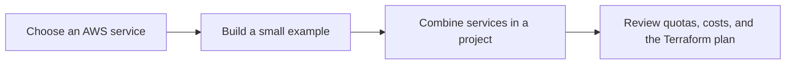

<h1 align="center">AWS Free Services, Used Well</h1>

<p align="center">
  A practical reference for AWS Always Free patterns, Terraform examples, and cost-aware project help.
</p>

<p align="center">
  <a href="https://aws.amazon.com/free/"></a>
  <a href="https://developer.hashicorp.com/terraform"></a>
  <a href="LICENSE"></a>
  <a href="https://github.com/ertodebana/2dollaraws"></a>
  <a href="#multi-service-projects"></a>
</p>

<p align="center">
  <a href="#start-here">Start here</a> ·
  <a href="#service-examples">Examples</a> ·
  <a href="#multi-service-projects">Projects</a> ·
  <a href="#cost-safety">Cost safety</a> ·
  <a href="#use-with-a-coding-agent">Coding agent</a>
</p>

> **Always Free means bounded, not unlimited.** AWS offers have quotas, account and Region rules, and exclusions. A Terraform plan cannot guarantee a $0 bill. Check the current offer and your billing console before creating resources.

## Start here

1. Read [HOWTO.md](HOWTO.md) before creating an AWS account or configuring credentials.
2. Pick a small [service example](#service-examples) or a [multi-service project](#multi-service-projects).
3. Read that folder’s README, inspect its Terraform, and run `terraform plan` before applying.
4. Clean up when you finish, then confirm the resources are gone in the AWS console.

### The learning path



<p align="center">
  <a href="examples/lambda-hello/"></a>
  <a href="examples/dynamodb-provisioned/"></a>
  <a href="examples/sqs-queue-dlq/"></a>
  <a href="examples/step-functions-hello/"></a>
  <a href="examples/cloudwatch-logs-alarm/"></a>
  <a href="examples/cloudfront-lambda-url/"></a>
  <a href="examples/cognito-user-pool/"></a>
  <a href="examples/codebuild/"></a>
</p>

## Service examples

Each example is an independent Terraform root with its own README, bounded settings, and cleanup instructions. Read the linked README for current limits and usage details.

<details open>
<summary><strong>Compute and container builds</strong></summary>

| Example | Learn | Keep in mind |
| --- | --- | --- |
| [Lambda hello](examples/lambda-hello/) | Deploy a small function with bounded log retention. | Requests, duration, networking, and logs have separate limits. |
| [CodeBuild](examples/codebuild/) | Run a no-source build with bounded compute. | Build minutes are shared; larger and GPU compute is paid. |
| [ECR Public](examples/ecr-public/) | Publish a small container image publicly. | Repository contents are public; image pulls use transfer allowances. |

</details>

<details>
<summary><strong>Data and storage</strong></summary>

| Example | Learn | Keep in mind |
| --- | --- | --- |
| [DynamoDB provisioned table](examples/dynamodb-provisioned/) | Set explicit read/write capacity on a small table. | Backups, streams, replicas, storage, and excess usage can cost extra. |
| [Aurora DSQL cluster](examples/aurora-dsql-cluster/) | Connect to a single-Region cluster with IAM authentication. | Cluster hours and storage have limits; destroy it when finished. |

</details>

<details>
<summary><strong>Messaging and workflow</strong></summary>

| Example | Learn | Keep in mind |
| --- | --- | --- |
| [SQS queue and DLQ](examples/sqs-queue-dlq/) | Configure a standard queue, dead-letter queue, and redrive policy. | Idle Lambda pollers can consume queue requests. |
| [SNS fanout to SQS](examples/sns-fanout-sqs/) | Deliver topic messages to a queue and optionally email a subscriber. | Confirm email subscriptions; avoid SMS and customer-managed KMS keys. |
| [EventBridge Scheduler](examples/eventbridge/) | Schedule a Lambda invocation with a least-privilege role. | Keep schedules sparse and bound runtime and log retention. |
| [Step Functions Standard](examples/step-functions-hello/) | Build a short workflow from native states. | Standard transitions are shared; Express has no Always Free allowance. |
| [Simple Workflow Service](examples/swf-domain/) | Create an SWF domain and register workflow types. | Domains cannot be deleted; destroy only deprecates them permanently. |

</details>

<details>
<summary><strong>Identity, operations, and security</strong></summary>

| Example | Learn | Keep in mind |
| --- | --- | --- |
| [Cognito user pool](examples/cognito-user-pool/) | Set up a Lite-tier user pool and public client. | Keep the tier explicit; SMS and custom domains may cost extra. |
| [Systems Manager Parameter Store](examples/ssm-parameter-store/) | Store standard String and SecureString parameters. | SecureString values appear in Terraform state; customer-managed keys cost extra. |
| [CloudTrail event history](examples/cloudtrail-event-history/) | Inspect the free 90-day management event history without a trail. | A trail adds S3 storage and request costs. |
| [CloudWatch logs and alarm](examples/cloudwatch-logs-alarm/) | Turn matching log lines into a metric and alarm on it. | Metrics, alarms, dashboards, ingestion, and retention share account limits. |
| [X-Ray Lambda tracing](examples/xray-lambda-tracing/) | Enable active tracing on a small Lambda function. | Trace recording and retrieval have separate monthly limits. |

</details>

<details>
<summary><strong>Networking, edge, and metrics</strong></summary>

| Example | Learn | Keep in mind |
| --- | --- | --- |
| [CloudFront with a Lambda URL](examples/cloudfront-lambda-url/) | Protect a Lambda function URL with CloudFront origin access control. | Requests, data transfer, and function calls share account allowances. |
| [Managed Prometheus](examples/managed-prometheus/) | Scrape and query Amazon Managed Service for Prometheus. | Ingestion, storage, and queries have separate limits; avoid paid compute dependencies. |

</details>

## Multi-service projects

These projects combine services into complete learning paths. Each has an independent Terraform root and README. Review the shared account budget before deploying several together.

<table>
  <tr>
    <td width="50%" valign="top">
      <h3><a href="projects/uptime-monitor/">📡 Uptime monitor</a></h3>
      <p>Scheduled URL checks, outage and recovery alerts, status history, and a dashboard.</p>
      <p><sub>Watch: CloudWatch metrics and alarms are account-wide limits.</sub></p>
    </td>
    <td width="50%" valign="top">
      <h3><a href="projects/account-cost-guardrail/">🛡️ Account cost guardrail</a></h3>
      <p>Budget emails and an automatic lock on a dedicated sandbox role.</p>
      <p><sub>Watch: keep the Terraform operator outside the role the brake can lock.</sub></p>
    </td>
  </tr>
  <tr>
    <td width="50%" valign="top">
      <h3><a href="projects/notes-api-auth/">🔐 Notes API with Cognito auth</a></h3>
      <p>A per-user notes API that verifies Cognito tokens inside Lambda.</p>
      <p><sub>Watch: public URLs receive traffic; verify JWTs before database access. Requires AWS provider 6.28+.</sub></p>
    </td>
    <td width="50%" valign="top">
      <h3><a href="projects/order-saga/">📦 Order saga</a></h3>
      <p>Order intake, stock reservation, mock payment, notifications, and compensation.</p>
      <p><sub>Watch: Step Functions transitions are shared across examples and projects.</sub></p>
    </td>
  </tr>
  <tr>
    <td width="50%" valign="top">
      <h3><a href="projects/webhook-ingest-queue/">📨 Webhook ingestion queue</a></h3>
      <p>Signed webhook intake, SQS buffering, idempotent processing, and a DLQ alert.</p>
      <p><sub>Watch: the worker defaults off because idle polling uses SQS requests. Requires AWS provider 6.28+.</sub></p>
    </td>
    <td width="50%" valign="top">
      <h3><a href="projects/ci-image-build/">🏗️ CI image build</a></h3>
      <p>CodeBuild publishes a container image to ECR Public and emails on failure.</p>
      <p><sub>Watch: build minutes are shared; only build repositories you control.</sub></p>
    </td>
  </tr>
  <tr>
    <td width="50%" valign="top">
      <h3><a href="projects/feature-flags-edge/">🌐 Feature flags at the edge</a></h3>
      <p>CloudFront caches flags from a protected Lambda URL backed by DynamoDB.</p>
      <p><sub>Watch: CloudFront Function invocations are the tightest request limit. Requires AWS provider 6.28+.</sub></p>
    </td>
    <td width="50%" valign="top">
      <h3><a href="projects/daily-digest/">🌍 Daily earthquake digest</a></h3>
      <p>A scheduled USGS summary stored in DynamoDB and emailed through SNS.</p>
      <p><sub>Watch: the daily schedule protects shared Step Functions transitions.</sub></p>
    </td>
  </tr>
</table>

## Cost safety

- This repository targets **Always Free offers only**. It does not count credits, trials, student benefits, or AWS Partner benefits as free.
- “Always Free” means free within the current offer’s limits and conditions, not unlimited usage.
- AWS can change offers. Check the [AWS Free Tier page](https://aws.amazon.com/free/) for the service, Region, account eligibility, and current limits before each deployment.
- Terraform cannot guarantee a $0 bill. Traffic, logs, data transfer, account settings, and usage outside an offer can be billed.
- Never commit credentials, private account IDs, Terraform state, or `.tfvars` files containing secrets.
- Review the plan before applying. Never run `terraform apply` or `terraform destroy` without understanding the exact resources and impact.

## Get help with your current project

Use this prompt while working in your existing project. It points the agent to this repository as a reference.

```text
Help me with the AWS project in my current repository. Use https://github.com/ertodebana/2dollaraws as a reference for Always Free services, Terraform patterns, cost limits, and cleanup guidance. Inspect my project and apply the relevant help to the task I give you.
```

## Contributing

See [HOWTO.md](HOWTO.md) for the account and safety workflow. Use a separate directory for each example or project, pin or constrain provider versions, list every AWS resource, identify cost drivers, and document cleanup. Link free-tier claims to official AWS sources and state the relevant limits and assumptions.

## License

MIT. See [LICENSE](LICENSE).
