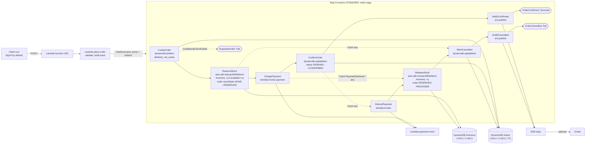

# Order saga

An e-commerce order workflow with stock reservation, a mocked payment, notifications, and compensating actions. Step Functions Standard orchestrates the saga. DynamoDB and SNS use direct integrations; the only business Lambda is the payment mock.

## User story

As a shop customer, I place an order for an item. Stock is reserved, the mock card charge runs, and the shop is notified. If payment is declined, or confirmation fails after a charge, the saga releases stock and refunds the mock payment. Conditional writes prevent overselling and make reserve/release idempotent.

## Architecture



## Resources

- Two provisioned DynamoDB tables: `${name}-orders` (1 RCU / 2 WCU, 7-day TTL by default) and `${name}-inventory` (1 RCU / 2 WCU). Point-in-time recovery and streams are off; DynamoDB's AWS-owned encryption key is used. The inventory table is seeded with `SKU-RED` (10), `SKU-BLUE` (10), and `SKU-LAST` (1). Terraform ignores changes to those seed items after creation so it does not reset stock.
- A standard SNS topic and an optional email subscription. Pending email subscriptions cannot be removed by Terraform; AWS expires them after 3 days. Email costs nothing while pending.
- Two Python 3.12 Lambda functions at 128 MB: `place-order` (3-second timeout, calls `StartExecution`) and `payment` (3-second timeout, deterministic charge/refund mock). Both have explicit 7-day log groups.
- A Lambda function URL with no CORS. `AWS_IAM` is the default. With `NONE`, two resource policy statements allow public URL invocation.
- Three least-privilege IAM roles: `place-order` can write its logs and start this state machine; `payment` can write its logs; Step Functions can update these two tables, invoke the payment function, and publish to this topic.
- One Step Functions **Standard** state machine with a 60-second timeout. Logging and tracing are off. It has no polling, Wait, Map, Parallel, or Express workflow states.

## Transitions per path

Every entered state counts, including terminal states and retry states.

| Path | States | Transitions |
|---|---|---:|
| Happy | CreateOrder, ReserveStock, ChargePayment, ConfirmOrder, NotifyConfirmed, OrderConfirmed | 6 |
| Out of stock | CreateOrder, ReserveStock, MarkCancelled, NotifyCancelled, OrderCancelled | 5 |
| Payment declined | + ChargePayment, ReleaseStock | 7 |
| Failure after charge | + ConfirmOrder, RefundPayment | 9 |
| Duplicate after 90 days | CreateOrder, DuplicateOrder | 2 |
| Worst case, all retries exhausted | Base failure path plus charge, refund, release, and notify retries | 17 |

## Combined free budget

| Allowance | Limit | order-saga | Rest of portfolio | Existing examples | Remaining at this project's ceiling |
|---|---:|---:|---:|---:|---:|
| Step Functions Standard transitions | 4,000 | ≤ 2,400; ≈ 350 typical | daily-digest ≈ 150 | step-functions-hello ≤ 200 | ≥ 1,250 |
| DynamoDB RCU / WCU (us-east-1) | 25 / 25 | 2 / 4 | Four other tables at ≤ 2 / 2 = 8 / 8 | dynamodb-provisioned 1 / 1 | 14 / 12 |
| SNS email deliveries | 1,000 | ≤ 300; ≈ 50 typical | digest 30, alerts < 100 | sns-fanout optional, a few | ≥ 570 |
| SNS publishes | 1,000,000 | ≤ 300 | < 1,000 | < 100 | ≈ 1,000,000 |
| Lambda requests | 1,000,000 | ≤ 700 | < 50,000 | small | large |
| Lambda compute | 400,000 GB-seconds | < 50 | small | small | large |

The binding constraint is Step Functions transitions. With roughly 8 transitions per order, 4,000 transitions would allow about 500 orders if no other workflow used the allowance. The listed shared portfolio ceiling keeps at least 1,250 transitions available.

These allowances are shared with other examples and projects in the account. The account-level combined budget and service sources are documented in the [project portfolio](../../README.md) and AWS pricing pages: [Step Functions](https://aws.amazon.com/step-functions/pricing/), [DynamoDB](https://aws.amazon.com/dynamodb/pricing/), and [AWS Free Tier](https://aws.amazon.com/free/).

## Always Free and cost notes

- Standard workflows include 4,000 state transitions per month indefinitely; Express has no free tier. Transitions are shared account-wide with every other state machine, and retries count too.
- Use this for a handful of learning orders. **Test with tens of orders, never a load script.** A public URL can spend the shared transition budget, so `AWS_IAM` is the default.
- If your account quota permits it, `place_order_reserved_concurrency` can cap concurrent starts. It defaults to `null`; some new accounts cannot set reserved concurrency.
- Both DynamoDB tables are fixed provisioned capacity, point-in-time recovery off, streams off, standard table class. Keep these settings and the 7-day order TTL to bound usage.
- The mock payment never contacts a payment provider and stores no real payment information. `simulate` exists only to exercise failure branches; remove that fault injection in a real system.
- `RefundPayment` and `ReleaseStock` deliberately have no `Catch`. If either compensation fails, the execution ends failed for an operator to inspect and handle manually. A lost-but-successful release response can cause its retry to hit the `stockState` guard and fail the execution while keeping the stock value correct.
- If state-machine logging is enabled manually, create and retain its CloudWatch log group deliberately; this example leaves logging off.
- There are no paid dependencies. The design uses no API Gateway, S3, NAT, VPC, public IP, customer-managed KMS key, or SMS.

## Requirements and permissions

Terraform 1.5+, AWS provider >= 6.28.0, < 7.0 (needed for `invoked_via_function_url` on the public Function URL permission; see [provider issue](https://github.com/hashicorp/terraform-provider-aws/issues/44829)), AWS CLI v2, curl, and an AWS identity allowed to create/delete the listed resources. The caller of an `AWS_IAM` function URL needs both `lambda:InvokeFunctionUrl` and `lambda:InvokeFunction` permissions on this function. Run Terraform with a non-root identity and the intended account/profile.

## Use

From this directory:

```sh
terraform init
terraform plan
terraform apply
```

Confirm the SNS email subscription from the message AWS sends. With `AWS_IAM`, export temporary credentials from your normal AWS profile, then use the output command:

```sh
export AWS_ACCESS_KEY_ID="$(aws configure get aws_access_key_id --profile personal)"
export AWS_SECRET_ACCESS_KEY="$(aws configure get aws_secret_access_key --profile personal)"
export AWS_SESSION_TOKEN="$(aws configure get aws_session_token --profile personal)"
```

The `x-amz-security-token` header in the generated `curl_example` applies to temporary credentials; omit it when using long-term credentials. Do not put credentials in files or shell history. A request can also be sent through a profile-aware SigV4 client. If `function_url_auth_type = "NONE"`, omit SigV4 and the token header; anyone who has the URL can start orders and consume the account's state-transition allowance.

Use the `order_url`, `orders_table`, `inventory_table`, and `state_machine_arn` outputs. The examples below assume `AWS_PROFILE=personal`, `AWS_REGION=us-east-1`, and that you copied the output URL into `ORDER_URL`.

```sh
export AWS_PROFILE=personal
export AWS_REGION=us-east-1
export ORDER_URL="$(terraform output -raw order_url)"
export STATE_MACHINE_ARN="$(terraform output -raw state_machine_arn)"
export ORDERS_TABLE="$(terraform output -raw orders_table)"
export INVENTORY_TABLE="$(terraform output -raw inventory_table)"
```

For each branch below, `inspect` shows the execution history and the durable order and inventory state. The CLI query finds the execution by its name (`orderId`).

```sh
inspect() {
  order_id="$1"
  sku="$2"
  execution_arn="$(aws stepfunctions list-executions --state-machine-arn "$STATE_MACHINE_ARN" --region "$AWS_REGION" --query "executions[?name=='$order_id'].executionArn | [0]" --output text)"
  aws stepfunctions describe-execution --execution-arn "$execution_arn" --region "$AWS_REGION"
  aws dynamodb get-item --table-name "$ORDERS_TABLE" --key "{\"orderId\":{\"S\":\"$order_id\"}}" --region "$AWS_REGION"
  aws dynamodb get-item --table-name "$INVENTORY_TABLE" --key "{\"sku\":{\"S\":\"$sku\"}}" --region "$AWS_REGION"
}
```

### 1. Happy path (`o-1`)

Send one order with `SKU-RED`; the endpoint responds `202` and returns the execution ARN.

```sh
curl --aws-sigv4 "aws:amz:${AWS_REGION}:lambda" --user "$AWS_ACCESS_KEY_ID:$AWS_SECRET_ACCESS_KEY" \
  -H "x-amz-security-token: $AWS_SESSION_TOKEN" -H 'content-type: application/json' \
  -d '{"orderId":"o-1","sku":"SKU-RED","qty":1,"amountCents":1999}' "$ORDER_URL"
inspect o-1 SKU-RED
```

The execution succeeds, the order is `CONFIRMED`, and available stock becomes 9.

### 2. Duplicate id (`o-1` again)

The same execution name cannot be started twice. The function returns `409`; inspect the original execution and its records:

```sh
curl --aws-sigv4 "aws:amz:${AWS_REGION}:lambda" --user "$AWS_ACCESS_KEY_ID:$AWS_SECRET_ACCESS_KEY" \
  -H "x-amz-security-token: $AWS_SESSION_TOKEN" -H 'content-type: application/json' \
  -d '{"orderId":"o-1","sku":"SKU-RED","qty":1,"amountCents":1999}' "$ORDER_URL"
inspect o-1 SKU-RED
```

Execution names remain reserved for 90 days. After that, the DynamoDB `attribute_not_exists` condition still prevents reusing an order already in the orders table.

### 3. Out of stock (`SKU-LAST`)

The seed has one unit. First order succeeds; the second gets cancelled because the conditional stock reservation cannot take a negative amount.

```sh
curl --aws-sigv4 "aws:amz:${AWS_REGION}:lambda" --user "$AWS_ACCESS_KEY_ID:$AWS_SECRET_ACCESS_KEY" -H "x-amz-security-token: $AWS_SESSION_TOKEN" -H 'content-type: application/json' -d '{"orderId":"o-2","sku":"SKU-LAST","qty":1,"amountCents":500}' "$ORDER_URL"
inspect o-2 SKU-LAST
curl --aws-sigv4 "aws:amz:${AWS_REGION}:lambda" --user "$AWS_ACCESS_KEY_ID:$AWS_SECRET_ACCESS_KEY" -H "x-amz-security-token: $AWS_SESSION_TOKEN" -H 'content-type: application/json' -d '{"orderId":"o-3","sku":"SKU-LAST","qty":1,"amountCents":500}' "$ORDER_URL"
inspect o-3 SKU-LAST
```

### 4. Payment declined (`o-4`)

`simulate=decline` raises a named error. The saga releases the reserved unit before marking the order cancelled.

```sh
curl --aws-sigv4 "aws:amz:${AWS_REGION}:lambda" --user "$AWS_ACCESS_KEY_ID:$AWS_SECRET_ACCESS_KEY" -H "x-amz-security-token: $AWS_SESSION_TOKEN" -H 'content-type: application/json' -d '{"orderId":"o-4","sku":"SKU-BLUE","qty":1,"amountCents":500,"simulate":"decline"}' "$ORDER_URL"
inspect o-4 SKU-BLUE
```

### 5. Failure after charge (`o-5`)

`simulate=fail_after_charge` makes the confirmation condition fail after the mock charge. The workflow refunds and then releases stock.

```sh
curl --aws-sigv4 "aws:amz:${AWS_REGION}:lambda" --user "$AWS_ACCESS_KEY_ID:$AWS_SECRET_ACCESS_KEY" -H "x-amz-security-token: $AWS_SESSION_TOKEN" -H 'content-type: application/json' -d '{"orderId":"o-5","sku":"SKU-BLUE","qty":1,"amountCents":500,"simulate":"fail_after_charge"}' "$ORDER_URL"
inspect o-5 SKU-BLUE
```

For an execution that fails inside `RefundPayment` or `ReleaseStock`, inspect its history and the order/inventory items, then reconcile manually. A real payment integration needs an idempotent refund process. Avoid repeating a compensation blindly: stock release has a guard against applying twice.

## Cleanup

Review the account and the destroy plan before removal:

```sh
aws sts get-caller-identity
terraform plan -destroy
terraform destroy
terraform state list
```

Confirm no state machine, tables, Lambda functions, log groups, SNS topic, or IAM roles remain. A pending email subscription can linger until AWS expires it. Check billing and the Free Tier usage page after cleanup; billing data can arrive late.
