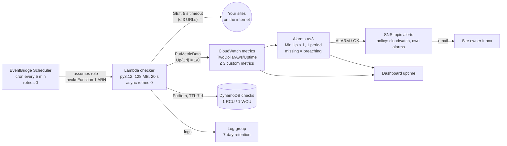

# Uptime monitor: scheduled HTTP checks, alarms and email alerts

A small, realistic project that checks up to 3 of your URLs every 5 minutes (or every minute), emails you when one goes down and again when it recovers, keeps a CloudWatch dashboard of the up/down history, and stores 7 days of raw check results (status code, latency, error) in DynamoDB.

A URL counts as **down** if the request fails, times out after 5 s, or returns a status outside 200-399.

## What it builds

1. `aws_scheduler_schedule.check`: `uptime-monitor-check` in the `default` group, `cron(0/5 * * * ? *)` (or `cron(* * * * ? *)`), UTC, flexible window off, 0 retries.
2. `aws_iam_role.scheduler` + `aws_iam_role_policy.scheduler_invoke`: trusted by `scheduler.amazonaws.com` from your account only; allowed only `lambda:InvokeFunction` on the checker.
3. `aws_lambda_function.checker`: `uptime-monitor-checker`, Python 3.12 (stdlib + boto3), arm64, 128 MB, 20 s timeout, no VPC, no function URL, no reserved concurrency.
4. `aws_lambda_function_event_invoke_config.checker`: 0 async retries, max event age 60 s.
5. `aws_cloudwatch_log_group.checker`: `/aws/lambda/uptime-monitor-checker`, 7-day retention, STANDARD class, no KMS.
6. `aws_iam_role.lambda` + `aws_iam_role_policy.lambda`: writes to the one log group, `cloudwatch:PutMetricData` only in namespace `TwoDollarAws/Uptime`, `dynamodb:PutItem` on the one table.
7. `aws_dynamodb_table.checks`: `uptime-monitor-checks`, PROVISIONED 1 RCU / 1 WCU, PK `url`, SK `ts`, TTL on `expires_at`, PITR and streams off, AWS-owned key.
8. `aws_sns_topic.alerts`: `uptime-monitor-alerts`, Standard, no KMS, no delivery-status logging.
9. `aws_sns_topic_policy.alerts`: only CloudWatch alarms named `uptime-monitor-*` in your account may publish.
10. `aws_sns_topic_subscription.email`: email to `alert_email`.
11. `aws_cloudwatch_metric_alarm.down` (one per URL, at most 3): `Minimum(Up) < 1` over one period, missing data = breaching, ALARM and OK actions to the topic.
12. `aws_cloudwatch_dashboard.uptime`: one `Up` graph and one alarm-status widget.



Not created: API Gateway, S3, VPC/NAT, KMS keys, SQS, composite or anomaly alarms, Synthetics canaries, Route 53 health checks.

What you learn:

- **Metric cardinality is the CloudWatch cost lever.** Each URL is one custom metric (`Up`, dimension `Url`) and one alarm. Latency and status codes go to DynamoDB and the logs, not to more metrics.
- **`treat_missing_data = "breaching"` is a dead-man's switch.** If the checker breaks or the schedule stops, the alarm still fires.
- **`cron`, not `rate`.** cron runs at the start of each period, so each datapoint lands in the right alarm period. `rate` starts from apply time and can drift across a boundary, leaving an empty (breaching) period.
- **TTL keeps history bounded.** Items expire after 7 days at no cost.
- **Least privilege across three principals:** the scheduler, the Lambda function, and CloudWatch publishing to SNS.

## User story and detection time

"As a site owner I want an email within about 5 minutes when one of my sites goes down, and another when it comes back."

With the 5-minute default, detection is about 5 minutes on average and about 6-7 minutes worst case (one interval, plus alarm evaluation, plus email delivery). Set `check_interval_minutes = 1` for about 1-3 minutes; it is still free.

## Always Free and cost notes

Sources (checked 2026-11-27): [AWS Free Tier](https://aws.amazon.com/free/), [CloudWatch pricing](https://aws.amazon.com/cloudwatch/pricing/), [EventBridge pricing](https://aws.amazon.com/eventbridge/pricing/), [Lambda pricing](https://aws.amazon.com/lambda/pricing/), [DynamoDB pricing](https://aws.amazon.com/dynamodb/pricing/provisioned/), [SNS pricing](https://aws.amazon.com/sns/pricing/). Offers change; confirm them before you apply.

**SNS email allowance:** the 1,000 email deliveries a month comes from the AWS Free Tier directory data on [aws.amazon.com/free](https://aws.amazon.com/free/). The [SNS pricing page](https://aws.amazon.com/sns/pricing/) no longer states it, so confirm it on the Free Tier page yourself.

Usage assumes 3 URLs and a 30-day month.

| Dimension | Always Free limit | 5-min interval (default) | 1-min interval |
|---|---|---|---|
| Scheduler invocations | 14,000,000/mo | 8,640 | 43,200 |
| Lambda requests | 1,000,000/mo | 8,640 | 43,200 |
| Lambda compute | 400,000 GB-s/mo | about 2,200 GB-s (worst case at the 20 s timeout about 21,600) | about 10,800 (worst case 108,000) |
| CloudWatch custom metrics | 10 per account | 3 | 3 |
| CloudWatch alarms | 10 standard-resolution alarm metrics | 3 | 3 |
| CloudWatch dashboards | 3, up to 50 metrics each | 1 dashboard, 3 metrics | same |
| CloudWatch API requests | 1,000,000 (excluding GetMetricData, GetInsightRuleReport, GetMetricWidgetImage) | 8,640 PutMetricData | 43,200 |
| CloudWatch Logs | 5 GB (ingestion + archive + Insights scans) | about 9 MB/mo | about 45 MB/mo |
| DynamoDB capacity | 25 RCU + 25 WCU per Region, shared by all tables | 1 RCU + 1 WCU | same |
| DynamoDB storage | 25 GB | about 1.2 MB (7-day TTL) | about 6 MB |
| SNS publishes | 1,000,000/mo | 2 per outage (ALARM + OK) | same |
| SNS email deliveries | 1,000/mo (Free Tier directory data, confirm) | 2 per outage per subscriber, normally < 50 | same |
| Data transfer out | 100 GB/mo aggregate | KB-scale GET requests | same |

**Shared account budget.** These allowances are per account, shared with everything else you run, including the `examples/`:

| Allowance | This project | Already used by `examples/` (if deployed) | Remaining after both |
|---|---|---|---|
| CloudWatch custom metrics (10) | 3 | 1 (`cloudwatch-logs-alarm`) | 6 |
| CloudWatch alarms (10) | 3 | 1 (`cloudwatch-logs-alarm`) + any DLQ alarm in `sqs-queue-dlq` | ≤ 6 |
| CloudWatch dashboards (3) | 1 | 1 (`cloudwatch-logs-alarm`) | 1 |
| DynamoDB RCU/WCU (25/25) | 1/1 | 1/1 (`dynamodb-provisioned`) | 23/23 |
| SNS emails (1,000) | < 50 normally | 0 by default | > 900 |
| Lambda requests (1M) | 8,640 (43,200 at 1 min) | a few hundred | > 900k |
| Scheduler (14M) | 8,640 | 720 (`eventbridge` at 1 hour) | about 14M |

- **The account gets only 10 free custom metrics and 10 free alarms in total. Each URL here is 1 metric and 1 alarm**, which is why `urls` is capped at 3. Beyond 10 it is $0.30 per metric-month and $0.10 per alarm-month.
- **`GetMetricData` is never free**, including from scripts and some third-party tools. Use the console or `aws cloudwatch get-metric-statistics`.
- **Flapping sites mean lots of email.** Each state change is one email. A URL flapping every interval could send thousands a month, past the 1,000 free. Pause with `schedule_state = "DISABLED"` or remove the URL. To reduce noise you can raise `evaluation_periods` and `datapoints_to_alarm` by hand (slower detection).
- Retries are 0 at both the scheduler and Lambda async layers, and the handler never raises on a failed check, so one tick is exactly one run.
- No VPC: a Lambda in a VPC would need a paid NAT gateway to reach the internet.
- DynamoDB stays PROVISIONED 1/1 with no autoscaling, GSI, streams, PITR, backups or KMS key.
- Email only: SMS has no free tier.
- The log group is created before the function with 7-day retention, so Lambda never auto-creates a never-expiring one.

## Requirements and permissions

- Terraform >= 1.5.0
- AWS CLI configured with an IAM Identity Center profile; review [HOWTO.md](../../HOWTO.md) first
- An email inbox you can confirm the SNS subscription from
- Operator permissions roughly like this (scope `Resource` to `uptime-monitor-*` names if you can):

```json
{
  "Version": "2012-10-17",
  "Statement": [
    {
      "Effect": "Allow",
      "Action": [
        "scheduler:CreateSchedule", "scheduler:UpdateSchedule", "scheduler:DeleteSchedule", "scheduler:GetSchedule",
        "lambda:CreateFunction", "lambda:UpdateFunctionCode", "lambda:UpdateFunctionConfiguration", "lambda:DeleteFunction",
        "lambda:GetFunction", "lambda:GetFunctionCodeSigningConfig", "lambda:ListVersionsByFunction", "lambda:TagResource",
        "lambda:PutFunctionEventInvokeConfig", "lambda:GetFunctionEventInvokeConfig", "lambda:DeleteFunctionEventInvokeConfig",
        "iam:CreateRole", "iam:DeleteRole", "iam:GetRole", "iam:TagRole", "iam:PassRole",
        "iam:PutRolePolicy", "iam:GetRolePolicy", "iam:DeleteRolePolicy", "iam:ListRolePolicies", "iam:ListAttachedRolePolicies", "iam:ListInstanceProfilesForRole",
        "logs:CreateLogGroup", "logs:DeleteLogGroup", "logs:PutRetentionPolicy", "logs:DescribeLogGroups", "logs:TagResource", "logs:ListTagsForResource", "logs:FilterLogEvents", "logs:StartLiveTail",
        "cloudwatch:PutMetricAlarm", "cloudwatch:DeleteAlarms", "cloudwatch:DescribeAlarms", "cloudwatch:TagResource", "cloudwatch:ListTagsForResource",
        "cloudwatch:PutDashboard", "cloudwatch:GetDashboard", "cloudwatch:DeleteDashboards", "cloudwatch:ListDashboards", "cloudwatch:GetMetricStatistics",
        "dynamodb:CreateTable", "dynamodb:DeleteTable", "dynamodb:DescribeTable", "dynamodb:UpdateTimeToLive", "dynamodb:DescribeTimeToLive",
        "dynamodb:DescribeContinuousBackups", "dynamodb:TagResource", "dynamodb:ListTagsOfResource", "dynamodb:Query",
        "sns:CreateTopic", "sns:DeleteTopic", "sns:GetTopicAttributes", "sns:SetTopicAttributes", "sns:TagResource", "sns:ListTagsForResource",
        "sns:Subscribe", "sns:Unsubscribe", "sns:GetSubscriptionAttributes", "sns:ListTopics",
        "sts:GetCallerIdentity"
      ],
      "Resource": "*"
    }
  ]
}
```

`iam:PassRole` is needed for both roles (Lambda execution role and scheduler role).

## Use

**Monitor only sites you own.** A 1-minute GET against someone else's site can be seen as abuse.

Check the handler logic locally (needs `boto3` installed, makes no AWS calls):

```sh
python3 handler.py
```

Deploy:

```sh
terraform init
terraform fmt -check
terraform validate
terraform plan  -var 'urls=["https://example.com"]' -var alert_email=you@example.com
terraform apply -var 'urls=["https://example.com"]' -var alert_email=you@example.com
```

Confirm the subscription from the email AWS sends. Before the first datapoint arrives, alarms may go ALARM and then OK; those first emails are not delivered while the subscription is still pending.

Test an outage by adding a URL that returns 404 (or a closed port):

```sh
terraform apply -var 'urls=["https://example.com","https://httpbin.org/status/404"]' -var alert_email=you@example.com
```

Watch the checks:

```sh
aws logs tail /aws/lambda/uptime-monitor-checker --since 15m
terraform output -raw history_command | sh     # last 10 results for the first URL
terraform output dashboard_url
```

Read the metric (use `get-metric-statistics`, not `get-metric-data`, which is never free):

```sh
aws cloudwatch get-metric-statistics --namespace TwoDollarAws/Uptime --metric-name Up \
  --dimensions Name=Url,Value=https://example.com --statistics Minimum --period 300 \
  --start-time "$(date -u -d '-1 hour' +%FT%TZ)" --end-time "$(date -u +%FT%TZ)"
```

### Pause

```sh
terraform apply -var 'urls=["https://example.com"]' -var alert_email=you@example.com -var schedule_state=DISABLED
```

Because missing data counts as breaching, pausing sends one ALARM email per URL. That is the dead-man's switch working.

## Cleanup

```sh
terraform plan -destroy -var 'urls=["https://example.com"]' -var alert_email=you@example.com
terraform destroy       -var 'urls=["https://example.com"]' -var alert_email=you@example.com
```

Then check nothing is left (schedule first, because a surviving schedule keeps invoking):

```sh
aws scheduler list-schedules --name-prefix uptime-monitor
aws lambda get-function --function-name uptime-monitor-checker              # expect ResourceNotFound
aws logs describe-log-groups --log-group-name-prefix /aws/lambda/uptime-monitor
aws cloudwatch describe-alarms --alarm-name-prefix uptime-monitor           # expect empty
aws cloudwatch list-dashboards --dashboard-name-prefix uptime-monitor       # expect empty
aws dynamodb describe-table --table-name uptime-monitor-checks              # expect ResourceNotFoundException
aws sns list-topics                                                         # no uptime-monitor-alerts
aws iam get-role --role-name uptime-monitor-checker-role                    # expect NoSuchEntity
aws iam get-role --role-name uptime-monitor-scheduler-role                  # expect NoSuchEntity
```

- A late invocation can recreate the log group after destroy; delete it by hand if it shows up.
- A `PendingConfirmation` email subscription can linger for up to 3 days at no cost.
- The `TwoDollarAws/Uptime` `Up` metrics can't be deleted. They stop counting once no data arrives and age out of `list-metrics` after about 2 weeks.
- `build/` is local build output only; delete it if you like.
