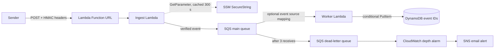

# Webhook ingest queue

A signed webhook receiver backed by SQS, an idempotent Lambda worker, DynamoDB, and a DLQ alarm. The worker event source mapping is **off by default** so idle pollers do not consume the account's SQS request allowance.

> [!IMPORTANT]
> This project pins AWS provider `~> 6.28` because public Lambda Function URLs require both `lambda:InvokeFunctionUrl` and an `InvokeFunction` permission conditioned on `lambda:InvokedViaFunctionUrl=true`. The repo's other examples use `~> 5.0`; this project needs the newer provider support and must not replace the condition with an unconditioned public `InvokeFunction` grant.

## What it builds

The public endpoint checks a timestamped HMAC-SHA256 signature before it reads the secret or sends anything to SQS. The worker writes a small conditional DynamoDB item for each event ID; duplicate deliveries count as success. Poison payloads and transient failures return partial batch failures and eventually move to the DLQ.



Terraform creates these 19 resource groups (the two IAM groups each contain a role and inline policy):

1. Standard-tier SSM SecureString at `/${name}/webhook-secret`, with a placeholder value.
2. Standard SQS dead-letter queue with 4-day retention and SQS-managed encryption.
3. Standard SQS main queue with 1-day retention, 60-second visibility, SQS-managed encryption, and redrive after 3 receives.
4. DLQ redrive allow policy scoped to the main queue.
5. Provisioned DynamoDB event table, default 1 RCU / 2 WCU, TTL enabled, PITR and streams off.
6. Ingest Lambda log group with 7-day retention.
7. Worker Lambda log group with 7-day retention.
8. Ingest IAM role and inline policy for logs, SQS send, and SSM read.
9. Worker IAM role and inline policy for logs, SQS receive/delete/attributes, and DynamoDB PutItem.
10. Python 3.12 ingest Lambda, 128 MB, 3-second timeout.
11. Buffered public Lambda Function URL, no CORS.
12. Function URL resource-policy permissions: `InvokeFunctionUrl` and the required conditional `InvokeFunction` statement.
13. Python 3.12 worker Lambda, 128 MB, 10-second timeout.
14. SQS event source mapping, batch size 10 and partial batch failure reporting, disabled by default.
15. Standard SNS topic with no KMS key.
16. Optional email subscription, created only when `alert_email` is nonempty.
17. Standard-resolution DLQ depth alarm with ALARM and OK notifications.
18. CloudWatch dashboard with vended SQS metrics and the alarm.
19. Two local Lambda zip archives created from `ingest.py` and `worker.py` by the Archive provider.

There is no API Gateway, S3, VPC, NAT gateway, customer-managed KMS key, provisioned-mode poller, custom metric, or autoscaling resource.

## Always Free and cost notes

AWS allowances are **account-wide and shared** with other examples and workloads. Recheck the current [AWS Free Tier](https://aws.amazon.com/free/) and service pricing before deployment.

| Dimension | Published allowance | This project |
|---|---:|---:|
| Lambda requests / compute | 1M requests and 400,000 GB-seconds/month | About 1,000 requests and 50 GB-seconds for 500 webhooks |
| SQS requests | 1M/month | About 4,500–9,000 for one 8-hour session with 500 messages; idle pollers dominate |
| DynamoDB provisioned capacity | 25 RCU and 25 WCU per Region | 1 RCU / 2 WCU by default, shared with other tables |
| DynamoDB storage | 25 GB | A few KB per 500 events; TTL expires records after 7 days by default |
| Standard Parameter Store | Standard parameters and standard throughput are free | One parameter; warm Lambda environments fetch at most once every 300 seconds |
| KMS requests | 20,000/month across Regions | AWS-managed SSM key decrypts, bounded by the 300-second cache |
| CloudWatch alarms / custom metrics / dashboards | 10 / 10 / 3 per account | 1 alarm, 0 custom metrics, 1 dashboard |
| CloudWatch Logs | 5 GB ingestion allowance | Small log lines; log groups retain 7 days by default |
| SNS publishes / email | 1M publishes / 1,000 email deliveries | Usually two email notifications per poison test (ALARM and OK) |
| Data transfer out | 100 GB/month aggregate | Tiny JSON responses |

**Idle SQS poller math:** AWS documents that an idle standard-queue event source mapping can optimize down to 2 pollers, or use a 5-poller low-traffic baseline. At the 20-second long-poll maximum, each poller makes at least 3 ReceiveMessage calls/minute: 129,600 requests/month each. That is **259,200/month (26% of the 1M allowance) with 2 pollers** or **648,000/month (65%) with 5 pollers**. An 8-hour session is about 2,880–7,200 empty receives. Actual wait behavior is not published; measure `NumberOfEmptyReceives`. Setting `worker_enabled=false` stops this polling and is the default.

Other cost bounds:

- The event body defaults to 16 KB and cannot exceed 32 KB, keeping each SQS request within one 64 KB chunk.
- The DynamoDB table stays in provisioned mode with explicit small capacity; it omits the server-side encryption block so it uses the AWS-owned key without KMS requests.
- No `provisioned_poller_config` is set; provisioned pollers have a paid EPU-hour charge. No `scaling_config` is set because it disables the two-poller idle optimization.
- The SSM parameter is explicitly Standard tier, and higher throughput must stay disabled. Setting or reading a SecureString uses the AWS-managed `aws/ssm` key, which has no monthly key fee.
- `GetMetricData` is not free. For CLI inspection use `get-metric-statistics` and keep dashboard visits occasional.
- A public endpoint can be flooded. Rejected calls still count as Lambda invocations, but they do not reach SSM, KMS, SQS, or DynamoDB. Optional reserved concurrency is off by default because some accounts cannot reserve concurrency under their quota.

Pricing references: [Lambda](https://aws.amazon.com/lambda/pricing/), [SQS](https://aws.amazon.com/sqs/pricing/), [Lambda SQS scaling](https://docs.aws.amazon.com/lambda/latest/dg/services-sqs-scaling.html), [Systems Manager](https://aws.amazon.com/systems-manager/pricing/), and [KMS](https://aws.amazon.com/kms/pricing/).

## Requirements and pre-flight

- Terraform >= 1.5.0, AWS CLI v2, and an AWS profile configured as described in [HOWTO.md](../../HOWTO.md).
- Review the exact plan and verify the account and Region before applying. This project uses AWS provider 6.x while other examples use 5.x.
- The CloudWatch alarm uses 1 of the account's 10 standard alarm slots.
- Confirm Parameter Store's account-and-Region defaults are Standard tier and standard throughput is off:

```sh
aws sts get-caller-identity
aws ssm get-service-setting --setting-id "arn:aws:ssm:${AWS_REGION}:${AWS_ACCOUNT_ID}:servicesetting/ssm/parameter-store/default-parameter-tier"
# SettingValue should be Standard
aws ssm get-service-setting --setting-id "arn:aws:ssm:${AWS_REGION}:${AWS_ACCOUNT_ID}:servicesetting/ssm/parameter-store/high-throughput-enabled"
# SettingValue should be false
```

If the worker role cannot decrypt the parameter through SSM, the fallback is `kms:Decrypt` on `arn:aws:kms:<region>:<account>:alias/aws/ssm` with `kms:ViaService` equal to `ssm.<region>.amazonaws.com`. Do not add a customer-managed key.

## Use

Start with the worker off:

```sh
terraform init
terraform fmt -check
terraform validate
terraform plan
terraform apply
```

Set a real secret out of band. The Terraform placeholder is public and the ingest Lambda returns 503 until it is replaced. The secret value does not enter Terraform state.

```sh
export AWS_REGION=us-east-1
export AWS_ACCOUNT_ID="$(aws sts get-caller-identity --query Account --output text)"
export WEBHOOK_URL="$(terraform output -raw webhook_url)"
aws ssm put-parameter \
  --name "$(terraform output -raw secret_param_name)" \
  --type SecureString --tier Standard --overwrite \
  --value "$(openssl rand -hex 32)" --region "$AWS_REGION"
export WEBHOOK_SECRET="$(aws ssm get-parameter \
  --name "$(terraform output -raw secret_param_name)" --with-decryption \
  --query Parameter.Value --output text --region "$AWS_REGION")"
```

Send three events and verify the endpoint responses. Keep the first ID to demonstrate worker deduplication later.

```sh
python3 send_webhook.py --url "$WEBHOOK_URL" --id demo-event-1
python3 send_webhook.py --url "$WEBHOOK_URL" --id demo-event-2
python3 send_webhook.py --url "$WEBHOOK_URL" --id demo-event-3
python3 send_webhook.py --url "$WEBHOOK_URL" --bad-sig
python3 send_webhook.py --url "$WEBHOOK_URL" --stale
aws sqs get-queue-attributes \
  --queue-url "$(terraform output -raw queue_url)" \
  --attribute-names ApproximateNumberOfMessages --region "$AWS_REGION"
```

The bad signature and stale timestamp should return 401. The accepted events should return 202 and wait in SQS while the worker is off. Turn the worker on only while processing messages:

```sh
terraform apply -var worker_enabled=true
aws dynamodb scan --table-name "$(terraform output -raw table_name)" --select COUNT --region "$AWS_REGION"
python3 send_webhook.py --url "$WEBHOOK_URL" --id demo-event-1
```

The count should remain 3 after the repeated ID is processed; the worker log records `DUPLICATE` without logging the body or secret.

Exercise the DLQ path:

```sh
python3 send_webhook.py --url "$WEBHOOK_URL" --type poison --id poison-demo
```

After the failed message is received three times, expect it in the DLQ after roughly 4–5 minutes and an ALARM email. `worker_enabled=false` can pause polling before recovery. The standard SQS redrive moves it back; because this payload remains poison, it returns to the DLQ. Purge it after the exercise to return the alarm to OK:

```sh
aws sqs start-message-move-task --source-arn "$(terraform output -raw dlq_arn)" --region "$AWS_REGION"
aws sqs purge-queue --queue-url "$(terraform output -raw dlq_url)" --region "$AWS_REGION"
```

When finished, disable the event source mapping or destroy the project. The event source mapping is the resource to remove first because its idle pollers consume SQS requests.

## Security and upgrade notes

- Rotate the SSM secret with another `put-parameter`; warm Lambda environments may keep the previous value for up to 5 minutes.
- The endpoint is public by design; the HMAC is the application authentication. A five-minute signed timestamp window rejects stale or far-future replays, and the worker's conditional event-ID write absorbs duplicate deliveries.
- The Terraform state contains only the placeholder. Do not paste the real secret into Terraform variables or files.
- The worker's idempotency write is the processing action in this demo. For external side effects, use an `IN_PROGRESS` / `DONE` record so retries cannot repeat a partial operation.
- A future rotation design can accept two secrets during overlap. Reserved concurrency is another optional safeguard, but defaults to unset.
- The Lambda Function URL requires the condition-scoped `InvokeFunction` permission. HashiCorp's [AWS provider issue and release record](https://github.com/hashicorp/terraform-provider-aws/issues/44829) places `invoked_via_function_url` in v6.28.0; that is why this project uses `~> 6.28`. The code does not grant wildcard `InvokeFunction` without the condition.

## Required IAM permissions

The operator's permissions should be limited to the selected region and this project's names. Terraform needs create/read/update/delete and tagging actions for Lambda, IAM roles and inline policies, SQS queues and redrive policies, DynamoDB, SSM parameters, SNS topics/subscriptions, CloudWatch alarms/dashboards/log groups, and the Archive data source's local file access. Include `iam:PassRole` for only the ingest and worker roles. For the exercise, the operator also needs `sqs:StartMessageMoveTask`, `sqs:PurgeQueue`, SQS queue attribute reads, DynamoDB scan, Lambda log reads, and SSM get/put parameter actions scoped to `/${name}/*`. The Parameter Store pre-flight checks need `ssm:GetServiceSetting` on the account's parameter-store setting ARNs. Never grant broad administrator access just to avoid scoping these permissions.

## Cleanup

First disable polling (or destroy the stack):

```sh
terraform apply -var worker_enabled=false
terraform plan -destroy
terraform destroy
```

Then confirm cleanup in the same account and Region:

- `aws lambda list-event-source-mappings --event-source-arn <main_queue_arn>` returns no mappings.
- `aws lambda get-function --function-name webhook-ingest-ingest` and `...-worker` return ResourceNotFound; the Function URL policy disappears with the ingest function.
- `aws sqs list-queues --queue-name-prefix webhook-ingest` returns no queues. Wait about 60 seconds before recreating the same names.
- `aws dynamodb list-tables` has no `webhook-ingest-events` table.
- `aws ssm describe-parameters --parameter-filters Key=Name,Option=BeginsWith,Values=/webhook-ingest` returns no parameter.
- `aws sns list-topics` has no `webhook-ingest-alerts` topic. A pending email confirmation may linger for up to 3 days at no cost.
- `aws cloudwatch describe-alarms --alarm-name-prefix webhook-ingest` and `aws cloudwatch list-dashboards --dashboard-name-prefix webhook-ingest` show no project resources.
- `aws logs describe-log-groups --log-group-name-prefix /aws/lambda/webhook-ingest` shows no groups. If a function ran after a log group was deleted, check again because Lambda can recreate it without retention.
- Both IAM roles no longer exist. Review Billing > Free Tier later; SQS request use should flatten after the mapping is gone.
